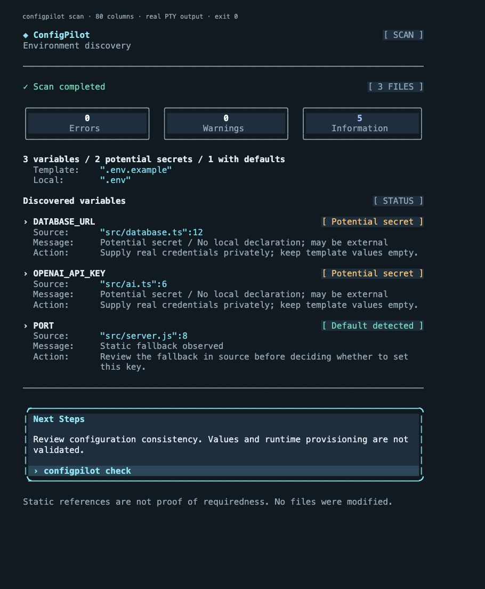
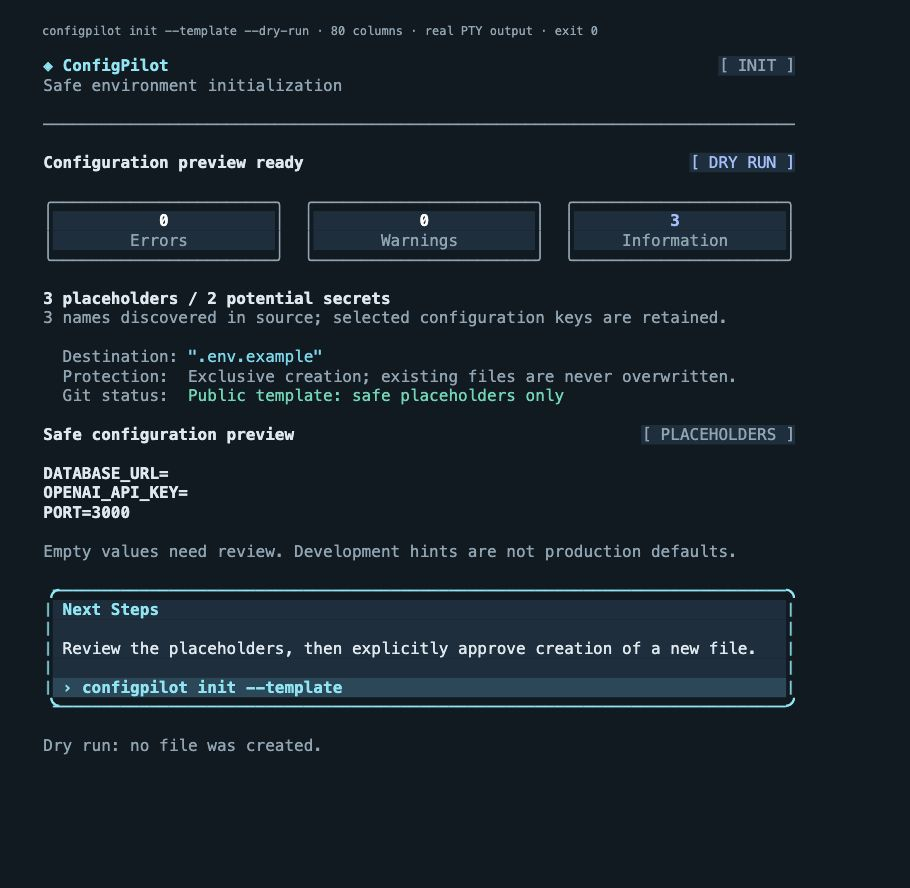
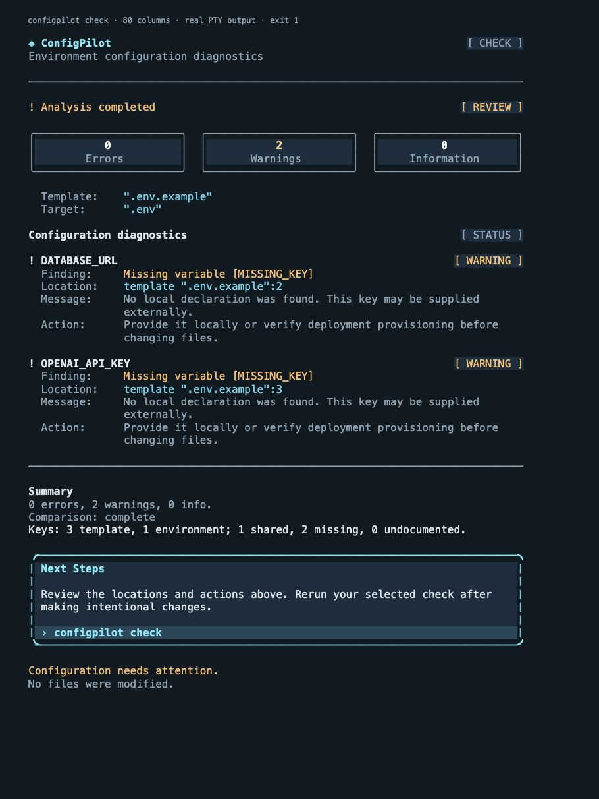

# Reference-led CLI design review — 2026-10-27

Status: implemented and captured; the owner subsequently authorized the v1.2.0 release
on 2026-10-27 after reviewing the supplied screenshots. Release execution/results are
tracked in RELEASE_PLAN_v1.2.0.md and PROGRESS.md. The visual refinement itself added
no dependency.

## Reference comparison before implementation

| Reference specification                                        | Previous CLI difference                                                                                     | Implemented adaptation                                                                                    |
| -------------------------------------------------------------- | ----------------------------------------------------------------------------------------------------------- | --------------------------------------------------------------------------------------------------------- |
| Compact brand at left, command pill at right                   | Command appeared directly beside the name                                                                   | Shared header row, right-aligned command badge; stacked fallback if needed                                |
| Muted subtitle and clear horizontal separation                 | Subtitle immediately led into unframed output                                                               | Shared subtitle, deliberate blank lines and full-width section rules                                      |
| Three visually separate metric blocks                          | Counts occupied one slash-separated text line                                                               | Three bordered, filled blocks with bold counts and muted labels                                           |
| Status at left, scan file count at right                       | Status/count shared an inline sentence                                                                      | Status row with right-aligned file-count or operation-state badge                                         |
| Variable names and status badges share aligned rows            | Badges appeared underneath variable names                                                                   | Right-aligned, color-coded status badges; long names retain all characters and stack status when needed   |
| Source locations under each name                               | No consistent diagnostic detail column                                                                      | Source/location, finding, message and action share a fixed label/body column; narrow output stacks labels |
| Prominent next-step container                                  | Unframed title, prose and command                                                                           | Cyan rounded frame, filled body and a separately highlighted command strip                                |
| Consistent space and typography                                | Scan/init/check/errors used different structures                                                            | One writer owns row, details, rules, metrics and panel geometry for every command                         |
| Dark panels, rounded corners and graphical icon                | No panel geometry; terminal has fixed character cells and theme colors                                      | ANSI backgrounds and Unicode box drawing in supported terminals; readable ASCII borders without color     |
| Graphic's Variables / Secrets / Defaults cards                 | Requested follow-up specifies severity counters instead                                                     | Errors / Warnings / Information in the cards; scan-specific counts remain a secondary line                |
| Graphic's illustrative v1.0 label and large proportional brand | Version text/font sizes would misrepresent this unreleased feature or rely on unsupported terminal controls | Compact bold monospaced branding; actual version remains available through --version                      |
| Outer rounded application container                            | Terminal output has no independent window surface                                                           | Terminal supplies the outer surface; only metric blocks and Next Steps are framed                         |

The image guides hierarchy, alignment, palette and grouping. Terminal widths, font
metrics and palette settings remain user-controlled. Severity colors supplement
explicit labels. Counters use actual diagnostics, without promoting uncertain scan
findings into definite errors. A potential-sensitive name is not proof of a secret.

## Actual terminal screenshots

These images show real ConfigPilot Node processes captured in POSIX PTYs, replayed
without changing their output bytes in [xterm.js](https://xtermjs.org/docs/api/terminal/classes/terminal/),
and photographed by the browser screenshot tool. They use a dark terminal palette.
They are terminal-emulator screenshots, not a certification of native Terminal.app,
iTerm2, Windows Terminal, PowerShell or Linux font rendering. The small caption above
each terminal is capture metadata, not CLI output.

Each process used an isolated synthetic fixture. No project code was executed and no
real configuration was read or overwritten. Scan/check inspected selected key names;
init preview wrote nothing. The explicit success capture created a disposable template
with --yes, then the fixture was removed. Command/exit/width/byte hashes are retained
in screenshots/cli-reference/transcripts/manifest.json; screenshot hashes are in
screenshots/cli-reference/manifest.json. The captured CLI has package version 1.1.1
in this unreleased checkout; npm v1.1.1 does not contain this design or scan/init.

### Scan

The brand/command anchors, three cards, source-first rows and right-aligned status
badges follow the reference's structure. A lower cyan panel emphasizes the next
command. Source classifications remain cautious and values never appear.

### Init

The same header/cards/panel frame a protected destination and safe placeholders.
Git status and exclusive creation are aligned with the other metadata. Dry-run and
creation status are explicit; previewing never grants permission to write.

### Check

The same three cards show analyzer counts. Severity badges align at the right;
finding codes, locations, explanations and actions align beneath each key. The panel
recommends the existing check command for default paths, or help for custom selections.
No shell command is constructed from arbitrary user-provided paths.

### State and responsive gallery

| Captured state                                     | Screenshot                                                          |
| -------------------------------------------------- | ------------------------------------------------------------------- |
| Narrow scan, three stacked cards                   | [40 columns](screenshots/cli-reference/scan-40.jpg)                 |
| Narrow init                                        | [40 columns](screenshots/cli-reference/init-40.jpg)                 |
| Narrow check                                       | [40 columns](screenshots/cli-reference/check-40.jpg)                |
| Successful check                                   | [Clean](screenshots/cli-reference/check-success-80.jpg)             |
| Syntax error plus informational skipped comparison | [Error](screenshots/cli-reference/check-error-80.jpg)               |
| Missing input, stderr / exit 2                     | [Operational error](screenshots/cli-reference/check-missing-80.jpg) |
| Empty discovery                                    | [Empty scan](screenshots/cli-reference/scan-empty-80.jpg)           |
| Empty initialization, no creation                  | [Empty init](screenshots/cli-reference/init-empty-80.jpg)           |
| Empty selected configuration files                 | [Empty check](screenshots/cli-reference/check-empty-80.jpg)         |
| Explicitly authorized template creation            | [Created](screenshots/cli-reference/init-created-80.jpg)            |

## Geometry, compatibility and security decisions

At 54 available cells or more, the metric cards share a row and distribute the
remainder deterministically. Below that, all three remain visible as stacked blocks.
Below 24 available cells, frames yield to plain labeled text. No terminal resizing,
cursor movement, spinner or window-setting sequence is emitted. Background/foreground
styling uses standard ANSI colors, disabled together with NO_COLOR/--no-color/TERM=dumb
under the existing stream policy. Non-TTY output uses ASCII borders and no ANSI unless
color is explicitly forced. Unicode icons have text labels and ASCII fallbacks.

Text is wrapped and measured before styling; CJK/combining characters and long names
are preserved. Default text-presentation checkmarks occupy one cell; explicit emoji
presentation remains two. Terminal fonts can differ, particularly around pictographs
and box-drawing glyph joins. Native platform/font checks remain separate release gates.

Quiet check output keeps findings and suppresses headers/cards/panels; clean checks
stay silent. JSON bypasses the display layout and retains exact report bytes, schema,
ordering and exit policy. Existing API exports, analysis and file creation semantics
are unchanged. Source/value sentinels remain covered by privacy regression tests.

Card counts: check uses analyzer totals; scan uses discovery diagnostic records;
init preview adds its safety warnings to discovery counts; init success shows creation
safety notices. Several records can concern one variable. Potential secrets, defaults,
file totals and placeholders remain separate metrics and never imply value validation.

## Reproduction and verification

`python3 scripts/capture-cli-design.py /absolute/new/capture-directory` captures the
13 real PTY transcripts with only Python's POSIX standard library and Node. It refuses
an existing capture directory. The viewer used an isolated @xterm/xterm@5.5.0 install
outside the repository. ConfigPilot gained no dependency. Terminal.app access and
sandbox listeners were unavailable; the owner started a temporary localhost server
for the synthetic viewer. No real data was served. The reference screenshot is not
embedded in or shipped with ConfigPilot.

Focused geometry and CLI tests cover 40/60/80/120/160 columns, both border alphabets,
exact counts, consistent badge edges/body columns, long Unicode paths/names, no-color,
quiet behavior and unchanged JSON. Existing privacy, workflow, API, type and package
checks are retained. Final executed results are recorded in PROGRESS.md.

Final local verification: npm run check passed 235 tests, seven independent contracts,
lint, formatting and installed TypeScript consumers. Coverage passed all 235 tests;
terminal rendering has 100% line / 98.96% branch coverage and discovery rendering
97.25% / 92.23%. Twenty focused layout/CLI tests also passed per runtime on Node
20.0.0, 22.13.0, 24.22.1 and 26.12.1 on macOS. Package inspection retained exactly
32 allowlisted files; screenshots/captures/configuration files are excluded. All 13
image/transcript manifest hashes were verified. The owner subsequently authorized release delivery after these screenshots.
